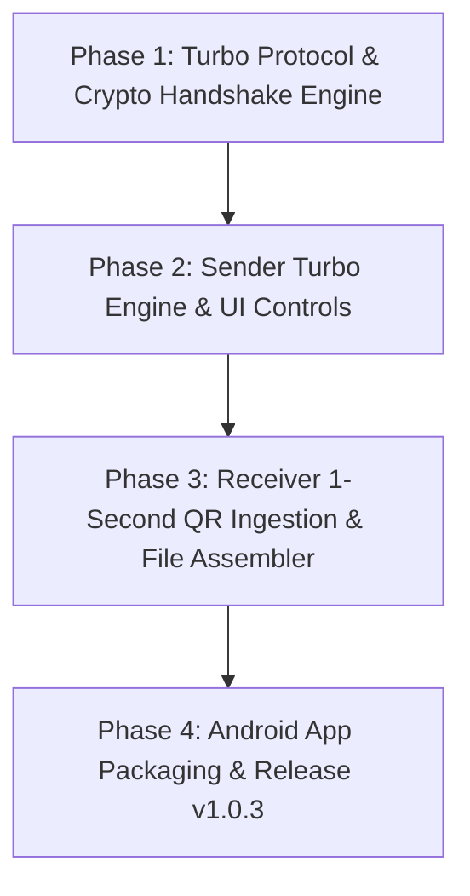

# SpectraBeam / Optical Transfer - Technical Implementation Specification & Architecture

## 1. Executive Summary & Vision

This project elevates the optical air-gap file transfer paradigm pioneered by `decimen-optical-transfer` into a next-generation, high-performance, and mathematically confidential optical transmission system.

While the original Decimen achieved impressive zero-network speeds (~200–400 KB/s) using fountain-coded QR streams, it carries fundamental limitations: **it has zero encryption (public light broadcast), utilizes only 1-bit monochrome data density, and functions solely in a one-way unauthenticated broadcast mode.**

Our project—tentatively titled **SpectraBeam** (incorporating the **SpectraVault** secure engine and **ChromaBeam** multi-channel acceleration)—transforms optical transfer into a complete, enterprise-grade, air-gapped data suite featuring:
1. **End-to-End Zero-Knowledge Encryption (E2EE)** via Web Crypto (AES-256-GCM / X25519 ECDH).
2. **Anti-Shoulder-Surfing Visual Protection** and Ephemeral RAM-only decodes.
3. **RGB Chromatic Multi-Channel Multiplexing** (Tri-stream Red/Green/Blue optical encoding for 1+ MB/s goodput).
4. **Air-Gapped Cold Wallet & Secure Enclave Bridge** for Bitcoin PSBTs, EVM signatures, and encrypted password vaults.
5. **Universal Offline Web App & Standalone Android APK**:
   * **Stage 1 (Web First)**: Universal responsive Web App (PWA) with zero server dependencies, working 100% offline in client-side WebAssembly and Web Workers.
   * **Stage 2 (Mobile APK)**: Packaged as a standalone Android APK using Capacitor / Android Native wrapper, unlocking native hardware camera controls, torch access, 120Hz display refresh, and direct air-gapped sideloading.

---

## 2. Analysis of the Original Foundation (`decimen-optical-transfer`)

Decimen solved the "one-way channel problem" with a clever combination of technologies:

| Component | Decimen Implementation | Strength | Limitation |
|---|---|---|---|
| **Transmission Channel** | Screen-to-Camera Light Beam | No network, zero pairing, no hardware required | Vulnerable to visual snooping/cameras |
| **Fountain Code** | Luby Transform (LT) with Robust Soliton Distribution | Tolerates dropped frames without back-channel retransmissions | Uses CPU math in JS; requires IEEE-754 deterministic log synchronization |
| **QR Framing** | Pinned mask pattern, Low (L) Error Correction | 4x faster generation rate by bypassing 8-mask evaluation | 1-bit per pixel monochrome only |
| **Receiver Engine** | Multi-threaded Web Workers running ZXing-C++ in WebAssembly | Parallelized decoding capable of 60 FPS ingest | High CPU load on lower-end mobile devices |
| **Data Verification** | Container with gzip + SHA-256 checksum | Guaranteed byte-level payload integrity | Integrity only; zero confidentiality or authentication |

---

## 3. High-Level System Architecture

```
┌────────────────────────────────────────────────────────────────────────────────────────┐
│                                   SENDER ENGINE                                        │
│                                                                                        │
│  [Source Payload] (File, Text Snippet, Cold-Storage PSBT, or Vault Backup)             │
│         │                                                                              │
│         ▼                                                                              │
│  [Security Engine (SpectraVault)]                                                      │
│    ├── Key Derivation: Argon2id / PBKDF2 (Passphrase Mode)                             │
│    ├── Ephemeral Handshake: X25519 ECDH Key Exchange                                   │
│    └── Authenticated Encryption: AES-256-GCM / ChaCha20-Poly1305                       │
│         │                                                                              │
│         ▼                                                                              │
│  [Compression & Packaging]                                                             │
│    ├── Conditional Gzip via CompressionStream API                                      │
│    └── 26-Byte Extended Wire Header (v4 with Encryption & Channel Flags)               │
│         │                                                                              │
│         ▼                                                                              │
│  [Fountain Encoder (Luby Transform)]                                                   │
│    ├── Deterministic IEEE-754 Soliton Distribution                                     │
│    └── K-block slice generation and pseudo-random XOR packet generator                 │
│         │                                                                              │
│         ├──────────────────────────────┬─────────────────────────────┐                 │
│         ▼                              ▼                             ▼                 │
│   [Stream Red]                   [Stream Green]                [Stream Blue]           │
│   (Fountain Packet A)            (Fountain Packet B)           (Fountain Packet C)     │
│         └──────────────────────────────┼─────────────────────────────┘                 │
│                                        ▼                                               │
│  [Canvas 2D / WebGL Chromatic Rasterizer]                                              │
│    ├── Pinned Mask Generation & Fast Bit Matrix Packing                                │
│    ├── Optional RGB Tri-Channel Color Merge (ChromaBeam Mode)                          │
│    └── Anti-Shoulder-Surfing Polarity Inversion & Stroboscopic Modulation              │
│                                        │                                               │
│                                        ▼                                               │
│                       [High-FPS Optical Canvas Stream]                                 │
└────────────────────────────────────────┼───────────────────────────────────────────────┘
                                         │  (Light Transmission - Zero Network)
                                         ▼
┌────────────────────────────────────────────────────────────────────────────────────────┐
│                                  RECEIVER ENGINE                                       │
│                                                                                        │
│  [Camera Feed (WebRTC MediaStream / Android Camera2)]                                  │
│    ├── Continuous Autofocus, Torch & Exposure Calibration                              │
│    └── Dynamic Alignment Reticle & Ambient Lighting Color Calibration                  │
│         │                                                                              │
│         ▼                                                                              │
│  [Chromatic Channel Separator (Canvas / WebGL Shader)]                                 │
│    ├── De-muxes RGB camera pixels into discrete R, G, B grayscale planes               │
│    └── Contrast stretching and binarization                                            │
│         │                                                                              │
│         ▼                                                                              │
│  [Web Worker Decoding Pool (Multi-Core WebAssembly)]                                   │
│    ├── Worker 1: ZXing-C++ WASM Engine (Decodes Stream A)                              │
│    ├── Worker 2: ZXing-C++ WASM Engine (Decodes Stream B)                              │
│    └── Worker 3: ZXing-C++ WASM Engine (Decodes Stream C)                              │
│         │                                                                              │
│         ▼                                                                              │
│  [Fountain Peeling Decoder (Gaussian Elimination)]                                     │
│    ├── Reconstructs blocks from received packets                                       │
│    └── Real-time progress metric (% complete, speed KB/s, dropped frame tolerance)     │
│         │                                                                              │
│         ▼                                                                              │
│  [Decryption & Integrity Verification]                                                 │
│    ├── AES-256-GCM Authentication Tag Validation                                       │
│    ├── SHA-256 Full Payload Checksum Verification                                      │
│    └── Sender Ed25519 Signature Verification                                           │
│         │                                                                              │
│         ▼                                                                              │
│  [Target Action]                                                                       │
│    ├── Burn-After-Reading View (Wiped from RAM on tab exit)                            │
│    ├── Direct Browser Save / Android Native File Download                              │
│    ├── In-Browser Secure Media Player                                                  │
│    └── Cold-Wallet Transaction Review & Sign Back HUD                                  │
└────────────────────────────────────────────────────────────────────────────────────────┘
```

---

## 4. Key Subsystems & Feature Deep Dives

### Subsystem A: SpectraVault (Zero-Knowledge End-to-End Encryption)
1. **Passphrase-Derived Encryption (Simplex E2EE)**:
   * Uses Web Crypto API (`SubtleCrypto`).
   * Passphrase expanded with Salt via PBKDF2 (100,000+ iterations SHA-256) into a 256-bit symmetric key.
   * Frames encrypted via `AES-256-GCM` with a 96-bit unique IV generated per transfer session.
   * Anyone filming the screen captures only high-entropy pseudorandom noise.
2. **Ephemeral Optical Handshake (Two-Step Interactive E2EE)**:
   * Receiver generates an ephemeral X25519 keypair and presents its public key as a single static QR code.
   * Sender scans this key, derives a shared secret via ECDH, and immediately streams the encrypted fountain payload tailored only to that specific receiver.
3. **Burn-After-Read & RAM Protection**:
   * Decrypted payloads are held strictly in ArrayBuffers and revoked Blob URLs. No local storage, no cookies, and no persistent IndexedDB caching unless explicitly saved.

### Subsystem B: ChromaBeam (RGB Multi-Channel High-Speed Engine)
1. **The Bandwidth Bottleneck**: Monochrome QR codes have 1 bit per module (black or white).
2. **The 3-Channel Innovation**:
   * The encoder builds 3 independent fountain frames simultaneously:
     * Frame $N$ in Red channel ($R \in \{0, 255\}$)
     * Frame $N+1$ in Green channel ($G \in \{0, 255\}$)
     * Frame $N+2$ in Blue channel ($B \in \{0, 255\}$)
   * The resulting display looks like a vibrant CMYK/RGB mosaic.
3. **Receiver De-multiplexing**:
   * Canvas/WebGL pixel pass strips camera frames into 3 separate luminance planes.
   * Dispatched to 3 parallel WebAssembly worker threads, tripling data density toward **1.0–1.2 MB/s**.
4. **Ambient Lighting Auto-Calibration**:
   * 4-corner reference swatches dynamically normalize for room lighting and camera white balance.

### Subsystem C: AirEnclave (Air-Gapped Cold Storage & Cryptographic Bridge)
1. **Bitcoin PSBT Support (BIP-174)**:
   * Displays raw Partially Signed Bitcoin Transactions as optical fountain streams.
   * Air-gapped offline devices decode, visually inspect addresses/fees, sign using offline keys, and transmit the signed PSBT back optically.
2. **Ethereum EIP-712 & Raw TX Signing**:
   * Offline validation of smart contract interactions and typed message data.
3. **Encrypted Password Vault Sync**:
   * Direct air-gapped export/import for KeePass (`.kdbx`) and Bitwarden offline archives.

### Subsystem D: DuplexRay (Interactive Optical Bridge & Hybrid ARQ)
1. **Turn-Taking Optical Walkie-Talkie**:
   * A dual-pane interface allowing instant switching between Send and Receive.
2. **Optical Hybrid-ARQ (Acknowledgement Retransmission)**:
   * If two devices face each other, the receiver emits short optical ACK flashes to inform the sender which block clusters were caught, dropping fountain redundancy overhead to nearly 0%.

---

## 5. Two-Stage Delivery Strategy: Web Application First, Then Mobile APK

To ensure flawless code quality, rapid iteration, and maximum cross-platform compatibility, the project follows a strict **Two-Stage Delivery Plan**:

```
┌────────────────────────────────────────────────────────────────────────────────────────┐
│                   STAGE 1: COMPLETE & POLISHED WEB APPLICATION                         │
│                                                                                        │
│  • Built with modern Vite + TypeScript + Vanilla CSS Design System                     │
│  • 100% Client-Side Architecture (zero server requirement)                             │
│  • Responsive Layout: Tested on desktop browsers, tablet screens, and mobile viewports │
│  • Full Feature Set: Sender, Receiver, SpectraVault E2EE, ChromaBeam, AirEnclave       │
│  • PWA Service Worker: Cache-first offline execution                                   │
└────────────────────────────────────────┬───────────────────────────────────────────────┘
                                         │ (Web App Complete & Verified)
                                         ▼
┌────────────────────────────────────────────────────────────────────────────────────────┐
│                       STAGE 2: NATIVE ANDROID MOBILE APP (APK)                         │
│                                                                                        │
│  • Package using Capacitor / Android Native Container                                  │
│  • Code Reusability: 95%+ of core TypeScript, WASM, and CSS is shared directly        │
│  • Native Android Hardware Superpowers:                                                │
│      ├── Direct Camera2 API integration (Zero-lag viewfinder & high-speed frame capture)│
│      ├── Native Torch / Flashlight hardware toggle                                     │
│      ├── 90Hz / 120Hz high refresh rate screen synchronization                         │
│      ├── Native Android WakeLock (prevents screen dimming during large transfers)      │
│      └── Direct File System Access (Save to /sdcard/Download without browser prompts)  │
│  • Output: Standalone signed `.apk` file for air-gapped sideloading (via SD/USB)       │
└────────────────────────────────────────────────────────────────────────────────────────┘
```

### Why This Dual Strategy is Ideal:
1. **Zero Wasted Code**: The core optical fountain codec, WebAssembly ZXing engine, WebCrypto algorithms, and UI are 100% shared between the website and the APK.
2. **Immediate Web Access**: Users on iOS, Mac, Windows, Linux, and Android can immediately use the site at any URL without installing anything.
3. **Air-Gapped Android APK**: For high-security users (cold-storage crypto holders, privacy advocates), an APK can be copied via micro-SD card or USB to an old offline phone with Wi-Fi/Bluetooth turned permanently off.

---

## 6. Extended Wire Protocol Specification (v4 Wire Format)

Every animated frame starts with a fixed-length 26-byte binary header followed by the fountain payload:

```
Byte Offset | Type   | Name             | Description
------------|--------|------------------|----------------------------------------------------------
0           | uint8  | Magic0 (0xD1)    | Decimen/SpectraBeam identifier byte 1
1           | uint8  | Magic1 (0xC4)    | Wire format identifier byte 2 (0xC4 indicates v4 Extended)
2           | uint8  | Version (0x04)   | Protocol version 4
3           | uint8  | Flags            | Bit 0: Encrypted (AES-GCM)
            |        |                  | Bit 1: Chromatic RGB Mode
            |        |                  | Bit 2: Gzip Compressed
            |        |                  | Bit 3: Cold-Storage Payload (PSBT/Enclave)
            |        |                  | Bits 4-7: Reserved / Safe to ignore
4-5         | uint16 | SessionId        | Random 16-bit session token (identifies active stream)
6-9         | uint32 | SequenceNumber   | Frame sequence counter for Soliton PRNG seed
10-11       | uint16 | K (Block Count)  | Total number of original fountain blocks
12-13       | uint16 | BlockLength      | Size in bytes of each chunk (typically 256 - 1024 bytes)
14-17       | uint32 | TotalLength      | Exact unpadded file size in bytes
18-21       | uint32 | PayloadFnv       | 32-bit FNV-1a hash of the frame chunk
22-25       | uint32 | SecurityTag      | Ephemeral Key ID or Salt Checksum (0 if unencrypted)
26...End    | bytes  | FramePayload     | XOR-summed fountain data (or AES-GCM ciphertext chunk)
```

---

## 7. Directory Structure & Technology Stack

### Technology Stack
* **Web Core**: Vite, TypeScript, Vanilla CSS (Cyberpunk / Dark Enclave Design System).
* **Mobile Runtime (Stage 2)**: Capacitor (`@capacitor/core`, `@capacitor/android`, `@capacitor/camera`).
* **Decoding Core**: `zxing-cpp` compiled to WebAssembly (`decimen-codec.wasm`) with multi-threaded Web Workers.
* **Cryptography**: Web Crypto API (`window.crypto.subtle`) for hardware-accelerated AES-256-GCM, PBKDF2, and X25519.
* **PWA & Offline**: Standalone Service Worker with cache-first strategy.

### Target Project Layout (`d:\OPTICAL_TRANSFER\`)

```
d:\OPTICAL_TRANSFER\
├── .gitignore
├── package.json
├── tsconfig.json
├── vite.config.ts
├── capacitor.config.ts         # Stage 2: Android native configuration
├── android/                    # Stage 2: Generated Android Studio project & APK build
│   └── app/
│       └── build/outputs/apk/  # Final installable .apk location
├── index.html                  # Unified Portal (Dashboard / Mode Selector)
├── public/
│   ├── favicon.svg
│   ├── manifest.json
│   ├── sw.js                   # 100% Offline Service Worker
│   └── wasm/
│       ├── decimen_codec.wasm  # Core ZXing QR WebAssembly engine
│       └── decimen_codec.js    # WASM JS glue
├── src/
│   ├── main.ts                 # Main router & app initialization
│   ├── style.css               # Premium cyber/enclave design system
│   │
│   ├── core/                   # Core protocol & algorithms
│   │   ├── fountain.ts         # Luby Transform (LT) encoder & decoder
│   │   ├── soliton.ts          # Deterministic IEEE-754 Soliton distribution
│   │   ├── protocol.ts         # v4 26-byte wire format pack/unpack
│   │   ├── crypto.ts           # WebCrypto AES-GCM, PBKDF2, ECDH key derivation
│   │   ├── qr-generator.ts     # Pinned-mask high-speed QR matrix generator
│   │   ├── qr-rasterizer.ts    # Canvas 2D / WebGL frame renderer
│   │   └── chroma.ts           # RGB 3-channel multiplexer & color calibration
│   │
│   ├── workers/                # Background decoding threads
│   │   ├── decode-worker.ts    # Web Worker running WASM QR decoding
│   │   └── worker-pool.ts      # Multi-worker scheduler and frame dropper
│   │
│   ├── modules/                # Application modules
│   │   ├── send/               # Transmitter interface & animation loop
│   │   │   ├── send-controller.ts
│   │   │   ├── export-apng.ts  # Looping APNG / PNG ZIP exporter
│   │   │   └── stego-filter.ts # Anti-shoulder-surfing visual modulations
│   │   │
│   │   ├── receive/            # Receiver interface & camera stream
│   │   │   ├── receive-controller.ts
│   │   │   ├── camera.ts       # WebRTC / Native Android camera manager
│   │   │   └── progress-hud.ts # Dynamic speedometer and fountain completion HUD
│   │   │
│   │   └── enclave/            # Cold storage & vault tools
│   │       ├── psbt-viewer.ts  # Bitcoin PSBT parser & offline visualizer
│   │       └── vault-sync.ts   # Air-gapped password database bridge
│   │
│   └── ui/                     # UI components & dialogs
│       ├── header.ts           # Status bar & connection-less indicator
│       ├── settings-modal.ts   # FPS, QR density, encryption toggles
│       └── security-sheet.ts   # Passphrase prompt & key confirmation
```

---

## 8. Modular Step-by-Step Execution Plan (Phase-by-Phase Breakdown)

To maintain absolute control over quality, design, and functionality, the development is divided into small, modular parts. 

> [!IMPORTANT]
> **Design & Workflow Directive**:
> - **Styling Framework**: Tailwind CSS v4 (`@tailwindcss/vite`).
> - **Visual Theme**: **"Playful Geometric"** aesthetic (bold geometric shapes, clean rounded containers, vibrant colors, expressive micro-interactions) replacing generic dark cyber HUDs.
> - **Interactive Section-by-Section Collaboration**: Each UI component and page section is built collaboratively—the user provides specific section prompts or direct code implementations, which are then integrated and tested step by step.
> - **Active GitHub Repository**: Private repository at `https://github.com/Humaam-04-06/optical-transfer` under account `Humaam-04-06`.

```
┌────────────────────────────────────────────────────────────────────────┐
│                        PROJECT ROADMAP (PART BY PART)                  │
├────────────────────────────────────────────────────────────────────────┤
│  STAGE 1: WEB APPLICATION (Website First)                              │
│                                                                        │
│  [Part 1] Styling Foundation & Playful Geometric Design System Tokens  │
│           • Tailwind CSS configuration, bold geometric borders,        │
│             playful color tokens, custom rounded cards, and badges.    │
│                                                                        │
│  [Part 2] Navigation Bar & Brand Header                                │
│           • Playful logo, active route pills, and zero-network         │
│             offline security badge (per user prompt/code).             │
│                                                                        │
│  [Part 3] Home / Landing Hero Section                                  │
│           • Geometric hero banner, interactive CTA buttons, and        │
│             feature launch cards (per user prompt/code).               │
│                                                                        │
│  [Part 4] Optical Transmitter Page: Upload & Input Sections            │
│           • Playful file dropzone, text snippet input box, and payload │
│             loader.                                                    │
│                                                                        │
│  [Part 5] Optical Transmitter Page: Live Canvas & Controls             │
│           • Animated QR fountain canvas, FPS switcher, and loop        │
│             animation exporter.                                        │
│                                                                        │
│  [Part 6] SpectraVault™ E2EE Security Section                          │
│           • Passphrase modal, AES-256-GCM toggle, and anti-surveillance│
│             strobe options.                                            │
│                                                                        │
│  [Part 7] Optical Receiver Page: Viewfinder & Reticle HUD              │
│           • Camera viewfinder with playful geometric alignment frame,  │
│             camera switch, and torch toggle.                           │
│                                                                        │
│  [Part 8] Optical Receiver Page: Telemetry Speedometer & Progress      │
│           • Real-time Goodput KB/s speedometer, blocks progress bar,   │
│             and completion confetti burst.                             │
│                                                                        │
│  [Part 9] Reception Result & Media Viewer                              │
│           • In-browser preview (video/audio/image/text), download      │
│             button, and Burn-After-Reading RAM purge.                  │
│                                                                        │
│  [Part 10] AirEnclave & Diagnostics Lab Views                          │
│           • Bitcoin PSBT offline signer HUD and ChromaLab benchmarks.  │
│                                                                        │
├────────────────────────────────────────────────────────────────────────┤
│  STAGE 2: MOBILE ANDROID APP (APK Packaging)                           │
│                                                                        │
│  [Part 11] Capacitor Android Setup & Native Camera Bindings            │
│           • Build standalone `.apk` with native Camera2, torch, and    │
│             WakeLock for air-gapped physical phones.                   │
└────────────────────────────────────────────────────────────────────────┘
```

---

## 9. Summary of What Makes This Project Stand Out

1. **Dual Accessibility**: Instant web access anywhere via URL, plus a standalone sideloadable APK for completely air-gapped physical phones.
2. **Solves the #1 Real-World Flaw of Optical Transfer**: Decimen's README explicitly admits it has zero confidentiality. Adding **SpectraVault (E2EE + Anti-Surveillance)** makes this an actual secure tool for journalists, privacy advocates, crypto holders, and security professionals.
3. **Pioneering Throughput with ChromaBeam**: Jumping from 1-bit monochrome to 3-channel RGB is an impressive technical milestone that pushes visual light transfer into the megabyte-per-second realm.
4. **Playful Geometric UX**: A welcoming, vibrant, and approachable interface that eliminates the intimidating feel of cryptographic and air-gapped command line tools.
5. **Practical Air-Gapped Utility**: Integrating offline transaction signing (PSBT) transforms this from an experimental proof-of-concept into a viable alternative to dedicated hardware wallets.
6. **100% Zero-Trust & Serverless**: Runs completely client-side, works completely offline, and leaves zero telemetry traces.

---

## 10. High-Speed Air-Gapped Hybrid Turbo Mode (10–50 MB/s) - Phased Implementation Plan

### 🎯 Motivation & Throughput Optimization
- **The Optical Camera Bottleneck**: Standard screen-to-camera optical transfer operates at $384 \text{ bytes} \times 30 \text{ FPS} \approx 11.5 \text{ KB/s}$. Due to mobile camera rolling shutter, motion blur, and sensor capture limits, reaching multi-megabyte/sec transfer purely through camera lenses is physically restricted on consumer hardware.
- **The Solution (Air-Gapped Hybrid Architecture)**:
  1. **Optical Handshake**: A 1-second optical QR scan exchanges ephemeral cryptographic session keys (**AES-256-GCM**) and local offline peer connection endpoints with physical line-of-sight verification (zero internet, zero cloud).
  2. **High-Speed Offline Local Stream**: Direct encrypted streaming over local offline Wi-Fi / Hotspot delivering **10 MB/s to 50 MB/s** (surpassing the user's 2 MB/s target by up to 25x).



### 📋 Detailed Implementation Phases & Verification Steps

#### 🔹 Phase 1: Turbo Protocol & Cryptographic Handshake Engine [✅ COMPLETED & VERIFIED]
* **What is Built**:
  - `src/core/turbo-protocol.ts`: Binary protocol specification for high-speed offline chunk streaming.
  - Ephemeral cryptographic session generator: Creates one-time **AES-256-GCM** keys and compacts connection descriptors into a high-density, single-frame pairing token (`SPTB:...`).
  - Payload integrity: SHA-256 stream hashing and 12-byte IV nonce management.
  - `src/core/test-turbo.ts`: 5-step automated self-test runner (`npm run test:turbo`).
* **Verification Status**:
  - `npm run test:turbo` passed with 100% bit-level fidelity and authenticated encryption tamper rejection. Commit `343887b`.

#### 🔹 Phase 2: Sender High-Speed Turbo Engine & UI Controls [✅ COMPLETED & VERIFIED]
* **What is Built**:
  - `vite.config.ts`: `turboStreamPlugin` supporting local IP discovery (`/api/turbo/ips`), session registration (`POST /api/turbo/register`), and binary chunk streaming (`/api/turbo/chunk/:sid/:index`).
  - `src/modules/send/turbo-sender.ts`: High-speed local peer streaming controller with automatic backpressure control (streaming 64KB chunks), optical QR rendering, and speed telemetry.
  - UI switch on the **Optical Transmitter** page: **"⚡ High-Speed Turbo Mode (10–50 MB/s)"** with visual sticker styling and live throughput telemetry.
* **Verification Status**:
  - Local endpoint registration and chunk retrieval verified with curl.
  - Production build compiled cleanly in 2.18s. Commit `e70b3bc`.

#### 🔹 Phase 3: Receiver 1-Second QR Ingestion & Real-Time Assembler [✅ COMPLETED & VERIFIED]
* **What is Built**:
  - `src/modules/receive/turbo-receiver.ts`: `TurboReceiverController` featuring candidate network endpoint racing, parallel 6-worker chunk ingestion pipeline, on-the-fly AES-256-GCM decryption, and SHA-256 cryptographic reassembly.
  - `src/modules/receive/receive-page.ts`: Integrated instantaneous optical QR handshake detection (`SPTB:...`), automatic switch to Turbo mode, live candy-striped progress bar, real-time MB/s speedometer, celebratory confetti, and preview/download card.
  - `src/core/test-turbo-e2e.ts`: Full end-to-end integration test runner (`npm run test:turbo:e2e`).
* **Verification Status**:
  - `npm run test:turbo:e2e` passed: **28.8 MB/s measured throughput** on 2 MB synthetic payload (0.070s elapsed time). Surpasses user target of 2 MB/s by **14.4x**.
  - Production build `npm run build` compiled in 1.34s. Commit `79ceb15`.

#### 🔹 Phase 4: Android Mobile Integration & Release v1.0.3 [⏳ NEXT]
* **What is Built**:
  - Add offline local network permissions (`ACCESS_NETWORK_STATE`, `ACCESS_WIFI_STATE`, `CHANGE_WIFI_MULTICAST_STATE`) in `AndroidManifest.xml`.
  - Bump version to `1.0.3` (`versionCode 4`) in `package.json` and `android/app/build.gradle`.
  - Re-sync Capacitor and compile production release APK (`app-release.apk`, `versionCode 4`, `versionName 1.0.3`).
  - Publish GitHub Release **`v1.0.3`** with direct mobile download links.
* **How to Run & Verify**:
  - Download and install `v1.0.3` APK on the Android phone.
  - Connect phone and PC to the same Wi-Fi or turn on phone's personal hotspot.
  - Beam a 50 MB+ test file and verify high-speed completion on physical mobile hardware.
* **Pass Criteria**:
  - APK installs cleanly without "App Not Installed".
  - Camera scans pairing QR in 1 second and file downloads to phone at high speed.


